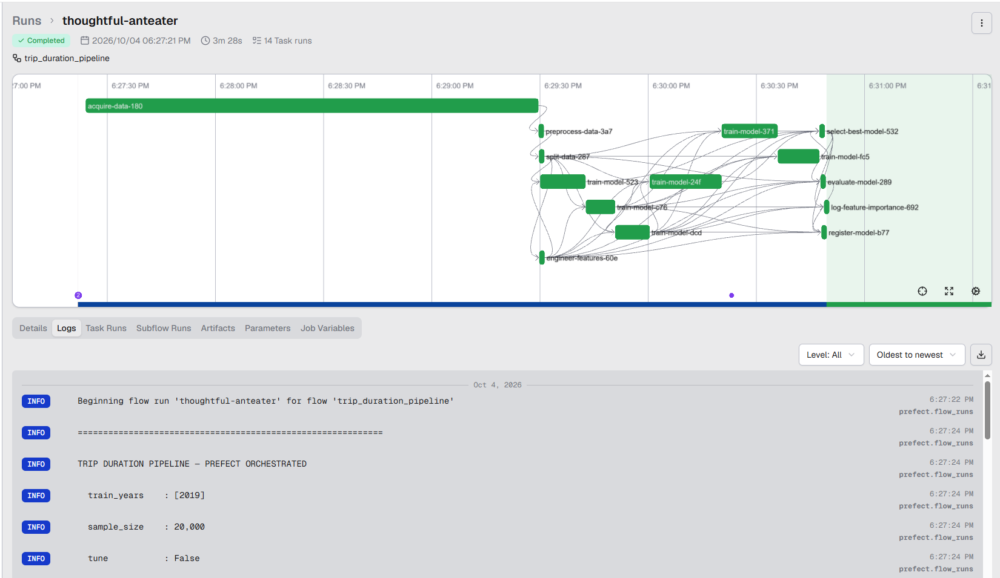
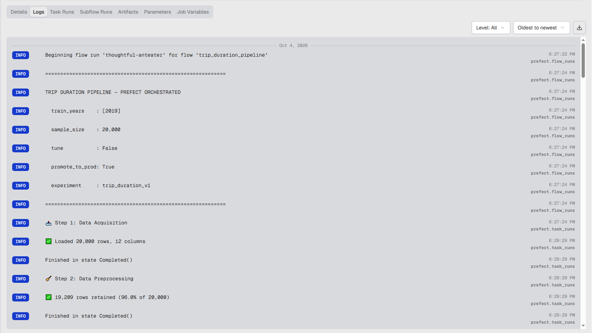
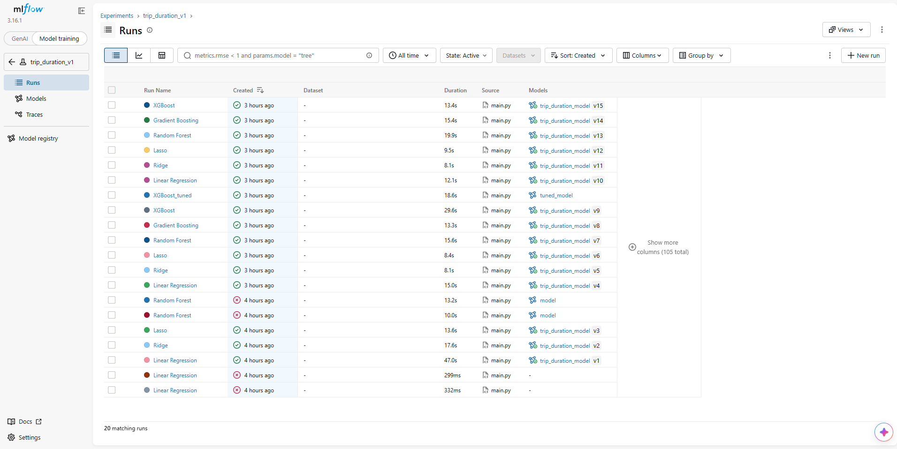
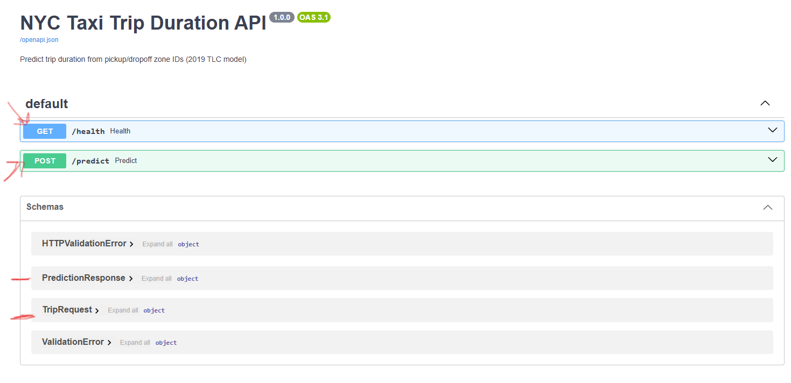

# NYC Taxi Trip Duration — MLOps Capstone Lab

> End-to-end ML pipeline predicting **NYC Yellow Taxi trip duration (minutes)** from 2019 TLC data.
> Orchestrated with **Prefect**, tracked/registered with **MLflow 3.x (aliases)**, served with **FastAPI**, deployable with **Docker**.

Developer: **Ahmed Akram Amer**

---

## 1. What this project does

1. **Downloads** NYC TLC Yellow parquet files from the official Website.
2. **Cleans + filters** trips, computes `trip_duration_minutes` target (no leakage).
3. **Splits** train/val/test *before* feature engineering.
4. **Engineers 23 features** from 8 prediction-time columns (zone-centroid distance, temporal/cyclical, airport flags, efficiency ratio, etc.).
5. **Trains 6 models** (Linear Regression, Ridge, Lasso, Random Forest, Gradient Boosting, XGBoost), picks winner by val `R²`.
6. **Tunes** winner with `HalvingRandomSearchCV` (optional).
7. **Evaluates** once on held-out test set (`R² / RMSE / MAE`).
8. **Registers** to MLflow Registry as `@challenger`, optionally promotes to `@champion`.
9. **Serves** via FastAPI `POST /predict` loading `models:/trip_duration_model@champion` + `preprocessor.pkl`.

## 2. Tech stack

| Layer                 | Tool                                                                                   | Notes                                                                                                                             |
| --------------------- | -------------------------------------------------------------------------------------- | --------------------------------------------------------------------------------------------------------------------------------- |
| Language              | Python`3.12` (`.python-version`)                                                   |                                                                                                                                   |
| Packages              | `uv` (`pyproject.toml`, `uv.lock`)                                               | Root:`fastapi[standard]`, `mlflow>=3.16`, `prefect>=3.8`, `xgboost>=3.4`. API slim: `pipeline/src/api/requirements.txt` |
| Orchestration         | Prefect 3.x`@flow` + `@task`                                                       | UI`http://127.0.0.1:4200`                                                                                                       |
| Tracking/Registry   | MLflow 3.x, SQLite`pipeline/mlflow_trip_duration.db`, artifacts `pipeline/mlruns/` | Aliases`champion` (=prod), `challenger` (=staging)                                                                            |
| Serving               | FastAPI + Uvicorn + Pydantic v2                                                        | `pipeline/src/api/main.py`                                                                                                      |
| Tuning                | `sklearn HalvingRandomSearchCV`                                                      | `n_candidates=6`, `cv=3`                                                                                                      |
| Features              | `Pipeline(TripFeatureEngineer → OutlierHandler(IQR) → RobustScaler)`               | 8 cols → 23 numeric features                                                                                                     |
| Deploy                | Docker`python:3.12-slim` + `uv`                                                    | `pipeline/src/api/Dockerfile`, `pipeline/src/docker-compose.yml`                                                              |

## 3. Repository layout

```text
capstone-lab/
├── README.md
├── pyproject.toml               # root deps, requires-python >=3.12
├── uv.lock
├── .python-version              # 3.12
├── pipeline/                    # ← ALL code runs from here
│   ├── main.py                  # CLI entrypoint (argparse → trip_duration_pipeline)
│   ├── flow.py                  # Prefect flow + 10 tasks
│   ├── mlflow_trip_duration.db  # SQLite tracking store
│   ├── mlruns/                  # MLflow artifacts
│   ├── config/config.py         # DataConfig / ModelConfig / MlflowConfig / load_config()
│   └── src/
│       ├── data/data_acquisition.py   # download + sample + validate
│       ├── data/data_preprocessing.py # clean + features/target split
│       ├── features/feature_engineering.py # TripFeatureEngineer + IQR + RobustScaler
│       ├── models/model_training.py   # 6-model portfolio + train/tune/evaluate
│       ├── models/model_registry.py   # champion/challenger aliases
│       └── api/main.py, schemas.py, model_loader.py, requirements.txt, Dockerfile
│       └── docker-compose.yml     # compose wrapper (context: pipeline/, mounts DB + mlruns)
```

Key defaults (`pipeline/config/config.py`): years `[2019]`, months `[1,4,7,10]`, duration `60-7200s`, distance `0.1-50mi`, pax `1-6`; experiment `trip_duration_v1`, model `trip_duration_model`, `min_r2_improvement=0.01`.

## 4. Prerequisites

- Python `3.12`, `uv` (`pip install uv`), Docker Desktop (optional), internet (TLC parquet download needs `pyarrow`).

## 5. Setup

```powershell
uv sync
cd pipeline
```

Optional env overrides:

```powershell
$env:MLFLOW_TRACKING_URI="sqlite:///capstone-lab/pipeline/mlflow_trip_duration.db"
$env:MLFLOW_EXPERIMENT_NAME="trip_duration_v2"
$env:MODEL_NAME="trip_duration_model"
$env:MODEL_ALIAS="champion"   # or challenger
```

## 6. Run the training pipeline (Prefect + MLflow)

```powershell
cd pipeline
uv run prefect server start   # separate terminal → http://127.0.0.1:4200

uv run python main.py --sample-size 20000 --no-tune          # fast smoke test
uv run python main.py --sample-size 50000 --tune             # small tuned run
uv run python main.py                                        # defaults (20k, tune ON)
uv run python main.py --sample-size 500000 --tune --promote  # prod: promote challenger → champion
uv run python main.py --sample-size 100000 --experiment-name trip_duration_v2
uv run python main.py --help
```

| Flag                       | Default              | Meaning                                          |
| -------------------------- | -------------------- | ------------------------------------------------ |
| `--sample-size N`        | `20000`            | Total rows sampled evenly across years × months |
| `--tune` / `--no-tune` | tune ON              | `HalvingRandomSearchCV` on winner              |
| `--promote`              | `False`            | Promote`@challenger → @champion`              |
| `--experiment-name`      | `trip_duration_v1` | Override MLflow experiment                       |

Flow (`flow.py: trip_duration_pipeline`): acquire (retries=3) → preprocess → split (before featurization) → engineer → train ×6 (retries=1) → select best (val R²) → tune → evaluate (test R²/RMSE/MAE) → register (`@challenger`/`@champion`, retries=2) → feature importance.

```python
import mlflow
mlflow.set_tracking_uri("sqlite:///mlflow_trip_duration.db")
model = mlflow.sklearn.load_model("models:/trip_duration_model@champion")
```

### 6.1 Pipeline in action (Prefect UI)

The full flow — acquire → preprocess → split → engineer → train ×6 → select best → evaluate → register — is orchestrated and visualized in the Prefect dashboard:



*Figure 1 — Prefect flow run: the task DAG and the per-task timeline.*



*Figure 2 — Prefect logs for the run: flow parameters plus each step's completion state.*

## 7. Inspect results (MLflow UI)

```powershell
cd pipeline
uv run mlflow ui --backend-store-uri sqlite:///mlflow_trip_duration.db --port 5000
# → http://127.0.0.1:5000, experiment trip_duration_v1, Models → trip_duration_model
```

### 7.1 MLflow experiment & model registry

All 6 model runs, their metrics, and the registered model versions are browsable in the MLflow UI:



*Figure 3 — MLflow experiment `trip_duration_v1`: the runs table with metrics/duration/source, and the `trip_duration_model` versions in the registry.*

## 8. Serve predictions (FastAPI)

```powershell
cd pipeline
$env:MODEL_NAME="trip_duration_model"; $env:MODEL_ALIAS="champion"
uv run -m uvicorn src.api.main:app --host 0.0.0.0 --port 8000 --reload
# Docs: http://127.0.0.1:8000/docs | Health: GET /health | Predict: POST /predict
```

```powershell
curl http://127.0.0.1:8000/health
curl -X POST http://127.0.0.1:8000/predict -H "Content-Type: application/json" -d '{\"tpep_pickup_datetime\":\"2019-01-15T14:30:00\",\"PULocationID\":161,\"DOLocationID\":237,\"passenger_count\":1,\"VendorID\":1,\"RatecodeID\":1,\"trip_distance\":2.5,\"payment_type\":1}'
```

Request fields (`schemas.py`): `PULocationID/DOLocationID 1-265`, `passenger_count 1-6`, `trip_distance >0`, `VendorID 1-2`, `RatecodeID/payment_type 1-6`, ISO `tpep_pickup_datetime`. Response: `prediction_duration_minutes`, `model_version`, `model_alias`.

### 8.1 Interactive API docs

FastAPI auto-generates an OpenAPI (Swagger) UI exposing the request/response schemas:



*Figure 4 — Swagger UI at `/docs`: `GET /health` and `POST /predict`, with the `TripRequest` / `PredictionResponse` schemas.*

## 9. Docker & Docker Compose (API)

Build context MUST be `pipeline/` (image needs `src/` + `config/` for pickle imports).

### 9.1 Recommended: Docker Compose

The compose wrapper lives at `pipeline/src/docker-compose.yml`. It is equivalent to the
`docker build` + `docker run` commands in §9.2, but declarative and reproducible:

```yaml
# pipeline/src/docker-compose.yml (summary)
services:
  api:
    image: trip-api
    build:
      context: ..                  # == pipeline/ (dockerfile is relative to context)
      dockerfile: src/api/Dockerfile
    ports: ["8000:8000"]
    environment:
      - MLFLOW_TRACKING_URI=sqlite:////app/mlflow_trip_duration.db
      - MODEL_NAME=trip_duration_model
      - MODEL_ALIAS=champion
      - MLFLOW_ARTIFACTS_ROOT=/app # remap host-absolute /mlruns/ paths → /app/mlruns/
    volumes:
      - ../mlflow_trip_duration.db:/app/mlflow_trip_duration.db
      - ../mlruns:/app/mlruns
```

What each part does:

| Key                                | Why it matters                                                                                                                                                                        |
| ---------------------------------- | ------------------------------------------------------------------------------------------------------------------------------------------------------------------------------------- |
| `context: ..`                    | Compose file is in`pipeline/src/`, so `..` = `pipeline/`. The `Dockerfile` does `COPY src/...` + `COPY config/...`, which only works with `pipeline/` as context.       |
| `dockerfile: src/api/Dockerfile` | Resolved**relative to `context`** (per Compose spec), i.e. `pipeline/src/api/Dockerfile`.                                                                                   |
| `MLFLOW_TRACKING_URI`            | Must be`sqlite:////app/mlflow_trip_duration.db` to match `WORKDIR /app` + the bind mount.                                                                                         |
| `MLFLOW_ARTIFACTS_ROOT=/app`     | The SQLite DB stores host-absolute artifact paths.`model_loader._remap()` strips everything before `/mlruns/` and prepends this, so `E:/.../mlruns/xxx` → `/app/mlruns/xxx`. |
| `volumes` (×2)                  | Mount**BOTH** the `.db` file and `mlruns/` or the API returns `404 Model Not Loaded` / `Preprocessor not found`.                                                        |
| `healthcheck`                    | Uses`python -c "urllib.request..."` because `python:3.12-slim` has no `curl` installed.                                                                                         |

Run it:

```powershell
cd pipeline/src
docker compose up --build        # build trip-api + start on http://localhost:8000
docker compose ps                # check status (should be healthy, not just running)
docker compose logs -f api       # tail Uvicorn startup logs
curl http://localhost:8000/health
curl -X POST http://localhost:8000/predict -H "Content-Type: application/json" -d '{\"tpep_pickup_datetime\":\"2019-01-15T14:30:00\",\"PULocationID\":161,\"DOLocationID\":237,\"passenger_count\":1,\"VendorID\":1,\"RatecodeID\":1,\"trip_distance\":2.5,\"payment_type\":1}'
docker compose down              # stop; add -v only if you use named volumes (bind mounts here are untouched)
```

Useful variants:

```powershell
docker compose up --build -d     # detached (background)
docker compose up --force-recreate --build   # full rebuild after Dockerfile/requirements change
MODEL_ALIAS=challenger docker compose up --build  # serve @challenger instead of @champion (Git Bash / Linux)
# PowerShell equivalent:
$env:MODEL_ALIAS="challenger"; docker compose up --build; $env:MODEL_ALIAS=$null
```

### 9.2 Alternative: raw `docker build` / `docker run`

Same thing compose does under the hood — handy for debugging:

```powershell
cd pipeline/src
docker build -f api/Dockerfile -t trip-api ./pipeline
docker run -p 8000:8000 -e MLFLOW_TRACKING_URI=sqlite:////app/mlflow_trip_duration.db -e MODEL_NAME=trip_duration_model -e MODEL_ALIAS=champion -v ${PWD}/pipeline/mlflow_trip_duration.db:/app/mlflow_trip_duration.db -v ${PWD}/pipeline/mlruns:/app/mlruns trip-api
curl http://localhost:8000/health
```

## 10. Cheat-sheet

```powershell
cd pipeline
uv run prefect server start
uv run mlflow ui --backend-store-uri sqlite:///mlflow_trip_duration.db
uv run python main.py --sample-size 20000 --no-tune
uv run python main.py --sample-size 500000 --tune --promote
uv run -m uvicorn src.api.main:app --host 0.0.0.0 --port 8000 --reload
# or: cd pipeline/src; docker compose up --build
```

## 11. Gotchas

- Always `cd pipeline` first — old root-level commands (`uvicorn src.api.main:app`, `docker build ... .`) were wrong paths.
- API needs a registered model with `preprocessor/preprocessor.pkl`; if `Preprocessor not found`, re-run pipeline with `--promote`.
- Docker/Compose: mount BOTH the `.db` file and `mlruns/`. Run compose from `pipeline/src/` (`docker compose up --build`).
- `pipeline/config/.env.example` is empty; use shell env vars from §5.
